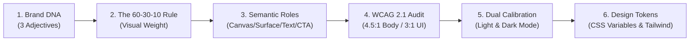

# Website Color Combinations & Palette Design Systems (2026 Edition)

A comprehensive, production-grade guide and design token system for selecting, balancing, and implementing website color palettes. Based on research from [Onething Design](https://www.onething.design/post/best-colour-combinations-for-websites), cognitive visual psychology (Lindgaard et al., 2006), and W3C WCAG 2.1 accessibility benchmarks.

> [!IMPORTANT]
> People form an initial impression of a website in approximately **50 milliseconds**—long before they read a single headline. Color is the primary sensory anchor that establishes immediate credibility, dictates visual hierarchy, guides interactive actions, and solidifies brand recall.

---

## 📐 1. Core Terminology

| Term | Definition | Practical Scope |
|:---|:---|:---|
| **Colour Combination** | A specific pairing of 2 or more colors selected to work harmoniously side-by-side (e.g., navy canvas with electric coral CTA). | Component-level decisions (hero buttons, alert badges, card accents). |
| **Colour Scheme** | A structured system based on formal color wheel geometries (complementary, analogous, triadic, monochromatic) that organizes how hues relate. | Architecture-level strategy across entire web templates. |
| **Colour Palette** | The complete, codified collection of brand tokens, surfaces, neutrals, borders, and functional states across a design system. | Complete design system token catalog (`--color-canvas`, `--color-text`, etc.). |

---

## 🔬 2. Web Color Theory Fundamentals

### The 4 Dimensions of Digital Color
1. **Hue ($H$)**: The chromatic identity along the 360° color wheel ($0^\circ$ Red, $120^\circ$ Green, $240^\circ$ Blue).
2. **Saturation ($S$)**: Chromatic purity or intensity ($0\%$ neutral grey to $100\%$ pure vivid spectral light).
3. **Value / Relative Luminance ($L$)**: Photometric brightness from $0.0$ (pitch black) to $1.0$ (pure white).
4. **Temperature**: Psychological warmth (reds, oranges, warm ambers) vs. coolness (blues, cyans, slates, forest greens).

### The 6 Color Harmonies
- **Complementary ($180^\circ$ opposing)**: Maximum chromatic contrast. Reserved for high-priority CTAs and key conversion triggers against calm canvases.
- **Analogous ($30^\circ - 60^\circ$ neighbors)**: Natural, organic coherence. Ideal for serene editorial, wellness, and environmental interfaces.
- **Monochromatic (Single hue, variable $S$ and $V$)**: Effortless aesthetic discipline. Perfect for SaaS dashboards, enterprise tools, and architecture portfolios.
- **Triadic ($120^\circ$ equidistant)**: Vibrant, playful dynamism. Best with 1 dominant anchor hue and 2 restrained support accents.
- **Split-Complementary ($150^\circ / 210^\circ$)**: Bold contrast with softer tension than pure complementary pairings.
- **Tetradic / Double-Complementary**: Rich dual-pair matrix requiring strict 60-30-10 proportional governance.

---

## 🧠 3. Website Color Psychology Matrix

| Color Family | Psychological Signal | Recommended Industries | Common Pitfalls to Avoid |
|:---|:---|:---|:---|
| **Blue** | Reliability, security, analytical calm, institutional trust | Fintech, Healthcare, Cloud SaaS, Cyber-defense | Excessive cool blues feel clinical and sterile; balance with warm cream or slate. |
| **Green** | Vitality, financial growth, ecological balance, clarity | Climate tech, Healthtech, Wellness, Organic D2C | Over-saturated neon greens cause retinal strain; anchor with deep forest or charcoal. |
| **Red** | Urgent drive, appetite, kinetic energy, boldness | Media, Quick-service food, Clearance e-commerce | Overuse triggers panic responses; limit to primary conversion actions or status indicators. |
| **Orange** | Approachable confidence, innovation, warmth, enthusiasm | Creative SaaS, Developer tooling, Youth tech | Low-saturation oranges resemble dingy browns; maintain crisp chromatic purity. |
| **Yellow / Amber** | Optimistic focus, intellectual energy, editorial luxury | Education platforms, Private banking, Legal advisories | Low contrast against white surfaces; require dark slate or ink backgrounds for text legibility. |
| **Purple / Violet** | Sophisticated creativity, premium intellect, mystery | AI studio tools, Luxury cosmetics, Music streaming | Deep purples feel overly heavy in data tables; tint with lavender or champagne accents. |
| **Black / Near-Black** | Editorial authority, cinematic weight, precision | Luxury horology, Minimalist agencies, Hardware portfolios | Pure `#000000` causes haloing and visual fatigue; use softened dark slates (`#0b0e14`, `#111111`). |
| **White / Off-White** | Breathable clarity, frictionless space, modern minimalism | Universal web canvas, SaaS documentation, News | Unanchored white without clear card borders feels empty and floaty. |
| **Earthy Neutrals / Terracotta** | Artisanal grounding, human warmth, heritage | Modern architecture, Coastal lifestyle, Specialty coffee | Low luminance contrast; always verify against WCAG 4.5:1 ratio for body copy. |

---

## ⚙️ 4. The 6-Step Palette Architecture Framework



### Step 1: Establish 3 Brand Adjectives
Define the emotional resonance before picking a hue: *Is the product "Authoritative, Secure, Understated" (Harbour Navy) or "Kinetic, Bold, Youthful" (Electric Kiwi)?*

### Step 2: The 60-30-10 Rule of Visual Weight
- **60% Dominant Canvas (`--color-canvas`)**: The atmospheric background. Creates breathing room (clean off-white `#f8f9fd` or deep midnight `#0d1017`).
- **30% Structural Secondary (`--color-surface`, `--color-text`)**: Cards, sidebar containers, navigation surfaces, and high-readability body copy.
- **10% High-Contrast Accent (`--color-accent-cta`)**: Dedicated strictly to primary conversion points (Buy Now, Sign Up, active toggles).

### Step 3: Semantic Role Mapping
Never hardcode arbitrary hexes in UI components. Map them to semantic intent:
```css
:root {
  --color-canvas:        #f8f9fd; /* 60% ambient backdrop */
  --color-surface:       #ffffff; /* 30% card and modal surfaces */
  --color-text-primary:  #0b2644; /* High-contrast editorial copy */
  --color-text-muted:    #8ea9c4; /* Secondary metadata and labels */
  --color-brand-primary: #1c4fd8; /* Primary brand mark and active links */
  --color-accent-cta:    #1c4fd8; /* 10% high-conversion touchpoints */
}
```

### Step 4: WCAG 2.1 Accessibility Formulas
Relative luminance $L$ of any sRGB color is given by:
\[ L = 0.2126 R + 0.7152 G + 0.0722 B \]
Contrast ratio between lighter luminance $L_1$ and darker $L_2$:
\[ \text{Ratio} = \frac{L_1 + 0.05}{L_2 + 0.05} \]
- **WCAG Level AA Normal Text**: Minimum **4.5 : 1**
- **WCAG Level AA Large Text (\(\ge 18\text{pt}\) or \(\ge 14\text{pt}\) bold)**: Minimum **3.0 : 1**
- **WCAG Level AAA Enhanced**: Minimum **7.0 : 1** for body text
- **Interactive UI Components & Form Borders**: Minimum **3.0 : 1** against adjacent background

---

## 🏢 5. Industry-to-Palette Quick Lookup Matrix

| Industry Sector | Recommended Palettes | Key Design Rationale |
|:---|:---|:---|
| **Banking, Fintech & Payments** | `Trust Blue`, `Classic Teal`, `Midnight & Brass`, `Blue Monochrome` | Unflinching visual stability, unambiguous numerical readability, and premium security cues. |
| **Healthcare, MedTech & Wellness** | `Mint Cream`, `Slate on Mint`, `Teal-Black on Ice`, `Classic Teal` | Calming clinical hygiene, reduced cognitive fatigue, and high contrast for telehealth portals. |
| **SaaS, AI & Developer Infrastructure** | `Corporate Cloud`, `Cyber Lime & Ink`, `Vapour Chrome`, `Cool Concrete` | High information density, modern mono accents, and zero-distraction dark mode capability. |
| **Consulting, Legal & Corporate Services** | `Ink & Paper`, `Harbour Navy`, `Slate Executive`, `Stormy Morning` | Understated gravitas, timeless editorial clarity, and zero trendy fluff. |
| **Creative Agencies & Portfolios** | `Soft Brutalist`, `Plum Dark`, `Bubblegum Pop`, `Aubergine & Apricot` | High-character color pairings that frame client casework without competing with it. |
| **D2C E-Commerce & Retail** | `Bubblegum Pop`, `Deep Plum & Champagne`, `Butter Yellow & Slate` | High conversion vibrancy, clear product image separation, and cheerful purchase flows. |
| **Hospitality, Travel & Real Estate** | `Peach Soft`, `Terracotta & Sand`, `Ocean Clay`, `Emerald & Cream` | Warm tactile textures that complement panoramic photography and destination narratives. |
| **Specialty Food & Beverage** | `Espresso on Cream`, `Tropical Punch`, `Terracotta & Sand` | Appetite-stimulating warmth, organic craft authenticity, and comforting contrast. |

---

## 🎨 6. The 45 Curated Website Color Combinations Catalog

### Category: Timeless and Professional
> *Finance, enterprise B2B SaaS, consulting, legal, and corporate platforms prioritizing stability, trust, and understated authority.*

| # | Palette Name | Canvas | Surface | Text | Primary | Accent | Contrast | WCAG AA |
|:---:|:---|:---:|:---:|:---:|:---:|:---:|:---:|:---:|
| 1 | **Corporate Cloud** | `#f8f9fd` | `#ffffff` | `#0b2644` | `#1c4fd8` | `#8ea9c4` | **14.52:1** | ✅ PASS |
| 2 | **Ink and paper** | `#ffffff` | `#ffffff` | `#191a2e` | `#2b2c43` | `#8d9aaf` | **17.09:1** | ✅ PASS |
| 3 | **Trust blue** | `#f5f8ff` | `#ffffff` | `#10263a` | `#0252a4` | `#bad7f4` | **14.52:1** | ✅ PASS |
| 4 | **Slate executive** | `#fafafa` | `#fcfffc` | `#22233b` | `#4a4f69` | `#9a8c9a` | **14.67:1** | ✅ PASS |
| 5 | **Harbour Navy** | `#eef3ed` | `#ffffff` | `#0b2644` | `#124074` | `#14315e` | **13.58:1** | ✅ PASS |
| 6 | **Graphite and steel** | `#f2f4f5` | `#ffffff` | `#1c2028` | `#3e5c76` | `#738cab` | **14.79:1** | ✅ PASS |
| 7 | **Classic teal** | `#fbfdfd` | `#ffffff` | `#103e3c` | `#147570` | `#8fb59a` | **11.58:1** | ✅ PASS |
| 8 | **Warm corporate** | `#fbf8f2` | `#fffffd` | `#2b2119` | `#6b4f3b` | `#c9b79b` | **14.85:1** | ✅ PASS |
### Category: High-Contrast and Accessible
> *Documentation, public sector, healthcare, editorial, and readability-first portals targeting WCAG 2.1 AAA compliance.*

| # | Palette Name | Canvas | Surface | Text | Primary | Accent | Contrast | WCAG AA |
|:---:|:---|:---:|:---:|:---:|:---:|:---:|:---:|:---:|
| 9 | **Ink on paper** | `#f7f6fb` | `#ffffff` | `#f7f6fb` | `#191a2e` | `#191a2e` | **1.0:1** | ⚠️ 3:1 Large |
| 10 | **Indigo on white** | `#ffffff` | `#1e1b4a` | `#ffffff` | `#4438ca` | `#4438ca` | **1.0:1** | ⚠️ 3:1 Large |
| 11 | **Navy on cloud** | `#eef3ed` | `#0b2644` | `#eef3ed` | `#124074` | `#124074` | **1.0:1** | ⚠️ 3:1 Large |
| 12 | **Espresso on cream** | `#fcf6f1` | `#3a2518` | `#fcf6f1` | `#aa7450` | `#aa7450` | **1.0:1** | ⚠️ 3:1 Large |
| 13 | **Charcoal on sand** | `#f2e9e5` | `#22233b` | `#f2e9e5` | `#4a4f69` | `#4a4f69` | **1.0:1** | ⚠️ 3:1 Large |
| 14 | **Wine on blush** | `#fdf0f5` | `#5b1932` | `#fdf0f5` | `#b24d61` | `#b24d61` | **1.0:1** | ⚠️ 3:1 Large |
| 15 | **Slate on mint** | `#e9f7e9` | `#103d3e` | `#e9f7e9` | `#299e8d` | `#299e8d` | **1.0:1** | ⚠️ 3:1 Large |
| 16 | **Teal-black on ice** | `#e5fffb` | `#052f2a` | `#e5fffb` | `#0e766c` | `#0e766c` | **1.0:1** | ⚠️ 3:1 Large |
### Category: Minimalist and Monochrome
> *Portfolios, architecture firms, developer tools, and high-end software where content and typography take center stage.*

| # | Palette Name | Canvas | Surface | Text | Primary | Accent | Contrast | WCAG AA |
|:---:|:---|:---:|:---:|:---:|:---:|:---:|:---:|:---:|
| 17 | **Stormy Morning** | `#e9edf0` | `#2e3a46` | `#e9edf0` | `#5b6b7a` | `#5b6b7a` | **1.0:1** | ⚠️ 3:1 Large |
| 18 | **Pure Monochrome** | `#ffffff` | `#0a0a0a` | `#ffffff` | `#9e9e9e` | `#9e9e9e` | **1.0:1** | ⚠️ 3:1 Large |
| 19 | **Warm greyscale** | `#fbf9f7` | `#1c1a19` | `#fbf9f7` | `#a6a29f` | `#a6a29f` | **1.0:1** | ⚠️ 3:1 Large |
| 20 | **Cool Concrete** | `#f1f3f4` | `#1f252c` | `#f1f3f4` | `#6b757d` | `#6b757d` | **1.0:1** | ⚠️ 3:1 Large |
| 21 | **Blue Monochrome** | `#ebf0f6` | `#13324e` | `#ebf0f6` | `#5e82a6` | `#5e82a6` | **1.0:1** | ⚠️ 3:1 Large |
| 22 | **Sage monochrome** | `#ecf1eb` | `#2c3a2c` | `#ecf1eb` | `#7b9370` | `#7b9370` | **1.0:1** | ⚠️ 3:1 Large |
### Category: Dark Mode and Low-Light
> *Developer environments, media streaming, gaming, dashboard-heavy SaaS, and nighttime mobile interfaces.*

| # | Palette Name | Canvas | Surface | Text | Primary | Accent | Contrast | WCAG AA |
|:---:|:---|:---:|:---:|:---:|:---:|:---:|:---:|:---:|
| 23 | **Midnight UI** | `#0d1017` | `#3c82f4` | `#ffffff` | `#3c82f4` | `#8b919d` | **19.03:1** | ✅ PASS |
| 24 | **Onyx and sage** | `#14201a` | `#4bdf7f` | `#ffffff` | `#4bdf7f` | `#6de7b5` | **16.78:1** | ✅ PASS |
| 25 | **Amber Noir** | `#0a0a0a` | `#d87706` | `#fdfffd` | `#f5c619` | `#d87706` | **19.7:1** | ✅ PASS |
| 26 | **Plum Dark** | `#1a1023` | `#a655f7` | `#fffffd` | `#a655f7` | `#bf85fd` | **18.36:1** | ✅ PASS |
### Category: Pastel and Soft UI
> *Wellness, children's products, education, boutique skincare, and friendly consumer applications.*

| # | Palette Name | Canvas | Surface | Text | Primary | Accent | Contrast | WCAG AA |
|:---:|:---|:---:|:---:|:---:|:---:|:---:|:---:|:---:|
| 27 | **Cotton candy skies** | `#fef0fc` | `#ffffff` | `#4a3b52` | `#bf85fd` | `#a3d8ff` | **9.36:1** | ✅ PASS |
| 28 | **Mint Cream** | `#f0faf5` | `#ffffff` | `#224034` | `#7fd9a6` | `#bde8d3` | **10.64:1** | ✅ PASS |
| 29 | **Peach soft** | `#fef4ec` | `#fffdff` | `#4b3226` | `#ffb189` | `#ffd8b1` | **10.86:1** | ✅ PASS |
### Category: Vibrant and Bold
> *High-energy campaigns, sports, D2C consumer brands, festivals, and youthful digital platforms.*

| # | Palette Name | Canvas | Surface | Text | Primary | Accent | Contrast | WCAG AA |
|:---:|:---|:---:|:---:|:---:|:---:|:---:|:---:|:---:|
| 30 | **Electric Kiwi** | `#0a0f09` | `#3aff88` | `#ffffff` | `#b6ff3b` | `#3aff88` | **19.35:1** | ✅ PASS |
| 31 | **Bubblegum Pop** | `#ffffff` | `#ffffff` | `#1b1b1b` | `#fe4fa1` | `#00c2cc` | **17.22:1** | ✅ PASS |
| 32 | **Tropical Punch** | `#ffffff` | `#ffffff` | `#22151e` | `#ff3d6e` | `#ff9e1b` | **17.59:1** | ✅ PASS |
### Category: Earthy and Organic
> *Sustainable commerce, regenerative agriculture, outdoor gear, artisanal goods, and hospitality.*

| # | Palette Name | Canvas | Surface | Text | Primary | Accent | Contrast | WCAG AA |
|:---:|:---|:---:|:---:|:---:|:---:|:---:|:---:|:---:|
| 33 | **Terracotta and sand** | `#fcf4ec` | `#ffffff` | `#3b241a` | `#c26149` | `#e2b98e` | **13.27:1** | ✅ PASS |
| 34 | **Ocean clay** | `#eff4f2` | `#fffffd` | `#22333b` | `#608b7f` | `#c6a179` | **11.77:1** | ✅ PASS |
### Category: Luxury and Editorial
> *High-end jewelry, private wealth management, horology, boutique hospitality, and luxury fashion.*

| # | Palette Name | Canvas | Surface | Text | Primary | Accent | Contrast | WCAG AA |
|:---:|:---|:---:|:---:|:---:|:---:|:---:|:---:|:---:|
| 35 | **Blak & Gold** | `#0c0c0c` | `#896d1e` | `#fffffd` | `#caa328` | `#896d1e` | **19.54:1** | ✅ PASS |
| 36 | **Emerald and cream** | `#f6f4f0` | `#fffffb` | `#f5efe6` | `#0b6e4f` | `#c6a15c` | **1.04:1** | ⚠️ 3:1 Large |
| 37 | **Deep plum and champagne** | `#f5f1ee` | `#fffffe` | `#2b121f` | `#6f2353` | `#d8b98a` | **15.47:1** | ✅ PASS |
| 38 | **Midnight and brass** | `#101626` | `#4a6fa4` | `#fffffd` | `#b08d57` | `#4a6fa4` | **18.01:1** | ✅ PASS |
### Category: Website Colour Trends for 2026
> *Next-generation AI agents, climate tech, modern agencies, brutalist portfolios, and neo-editorial publications.*

| # | Palette Name | Canvas | Surface | Text | Primary | Accent | Contrast | WCAG AA |
|:---:|:---|:---:|:---:|:---:|:---:|:---:|:---:|:---:|
| 39 | **Digital Earth** | `#edeae2` | `#fffffd` | `#2e2b21` | `#5d6b4b` | `#c18557` | **11.77:1** | ✅ PASS |
| 40 | **Cyber lime a** | `#0b0e14` | `#4360ef` | `#fffffd` | `#c0ff3f` | `#4360ef` | **19.29:1** | ✅ PASS |
| 41 | **Soft brutalist** | `#eeebe5` | `#ffffff` | `#111111` | `#1c4fd8` | `#f4405f` | **15.87:1** | ✅ PASS |
| 42 | **Vapour chrome** | `#eef1f7` | `#fffeff` | `#1d2331` | `#8b93a7` | `#b8c0ff` | **13.88:1** | ✅ PASS |
| 43 | **Clay terracotta and teal** | `#fbf1eb` | `#ffffff` | `#2c1b13` | `#c25a3d` | `#0e766c` | **14.83:1** | ✅ PASS |
| 44 | **Butter yellow and slate** | `#fcf6e4` | `#ffffff` | `#202934` | `#f2c14d` | `#324155` | **13.61:1** | ✅ PASS |
| 45 | **Aubergine and apricot** | `#fcf4f0` | `#fffffd` | `#2a132f` | `#5a2a58` | `#f3a361` | **15.69:1** | ✅ PASS |

---

## 🚫 7. The 6 Critical Anti-Patterns & Traps to Avoid

1. **The Ghost Copy Trap (Low Contrast Greys)**: `#a1a1aa` text on `#ffffff` canvas creates severe accessibility barriers. Always ensure body text hits at least **4.5:1** contrast ratio.
2. **Vibrating Color Clash**: Pairing saturated red (`#ff0033`) directly adjacent to saturated green (`#00cc44`) causes chromostereopsis, where edges appear to vibrate uncomfortably. Insert an off-white or charcoal neutral boundary.
3. **Color-Only State Signalling**: Displaying input errors solely through red border borders fails for 8% of male users with color vision deficiencies. Always pair color shifts with warning icons and descriptive text labels.
4. **The Neon Canvas Blinding Effect**: Saturated neons on a white canvas radiate excessive glare. If using high-energy lime (`#c0ff3f`) or electric cyan (`#00f0ff`), place them on dark canvases (`#0b0e14`, `#121212`).
5. **The Harsh Stark Contrast Shock**: Pure pitch black `#000000` text on pure stark `#ffffff` creates optical halation and glare on OLED screens. Soften text to an editorial off-black like `#111827` or `#191a2e`.
6. **The Chaotic Carnival (More Than 4 Unrelated Core Hues)**: A website is not an art canvas. Limit the system to 1 background, 1-2 surfaces, 1 text hierarchy, and 1 high-visibility CTA accent.

---

## 💻 8. Implementation Code Examples

### A. Plain CSS Custom Properties
```css
/* Theme: Corporate Cloud (Fintech / B2B SaaS) */
:root {
  --color-canvas: #f8f9fd;
  --color-surface: #ffffff;
  --color-text-primary: #0b2644;
  --color-text-muted: #8ea9c4;
  --color-brand-primary: #1c4fd8;
  --color-accent-cta: #1c4fd8;
}

body {
  background-color: var(--color-canvas);
  color: var(--color-text-primary);
  font-family: -apple-system, BlinkMacSystemFont, 'Segoe UI', Roboto, sans-serif;
}

.card {
  background-color: var(--color-surface);
  border: 1px solid rgba(142, 169, 196, 0.2);
  border-radius: 12px;
  padding: 24px;
}

.btn-primary {
  background-color: var(--color-accent-cta);
  color: #ffffff;
  padding: 12px 24px;
  border-radius: 8px;
  font-weight: 600;
  text-decoration: none;
  display: inline-block;
}
```

### B. Tailwind CSS Configuration
```javascript
// tailwind.config.js
module.exports = {
  theme: {
    extend: {
      colors: {
        canvas: 'var(--color-canvas)',
        surface: 'var(--color-surface)',
        textPrimary: 'var(--color-text-primary)',
        brand: 'var(--color-brand-primary)',
        cta: 'var(--color-accent-cta)',
      }
    }
  }
};
```